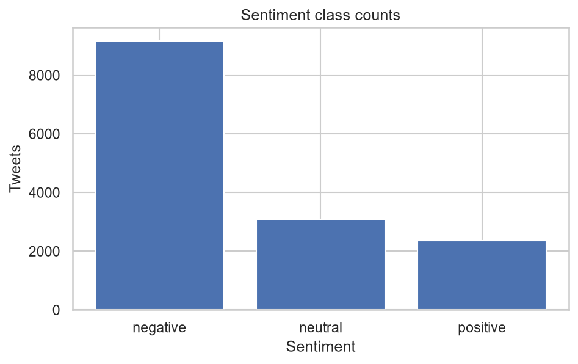
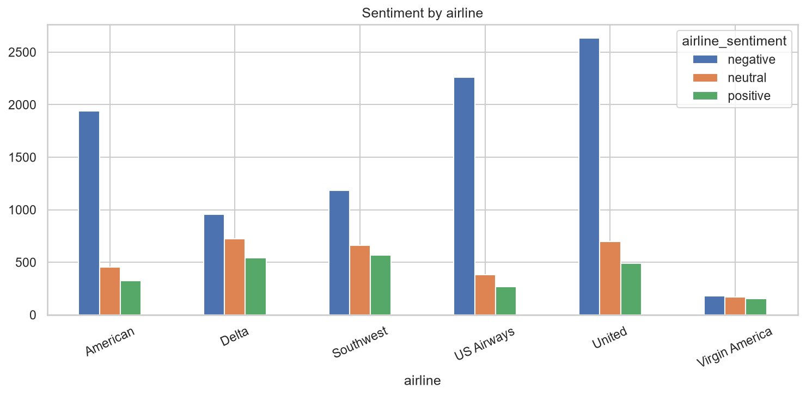
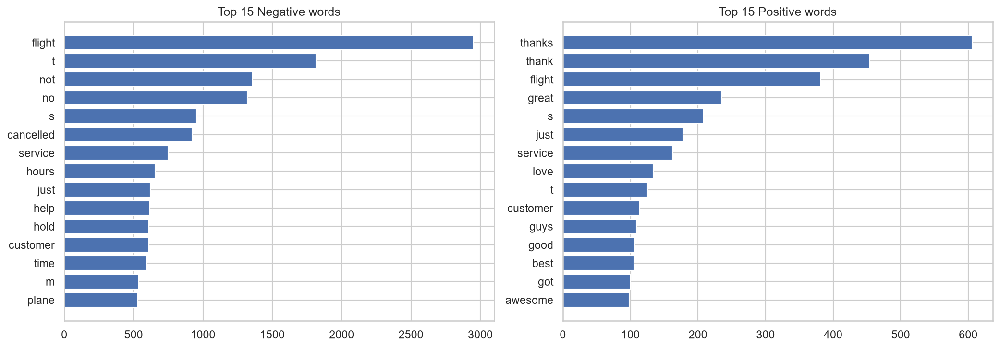
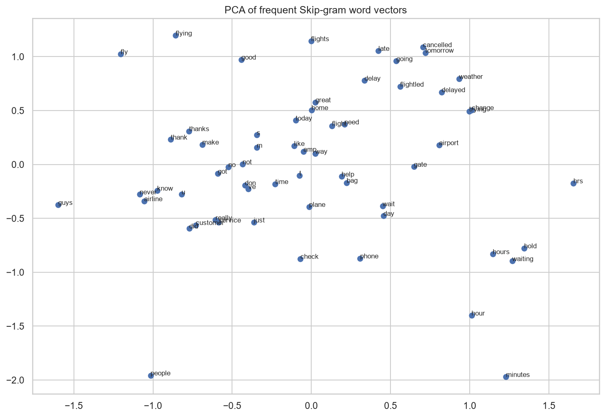
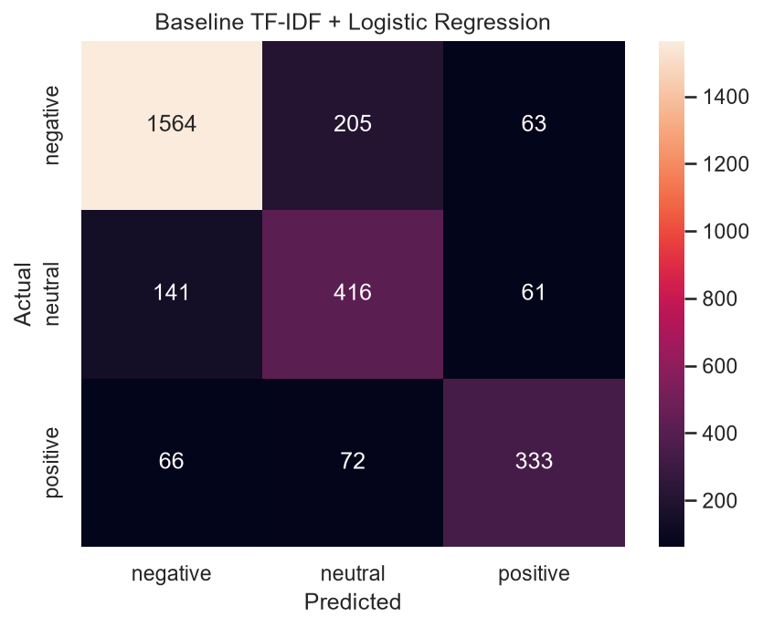

# ✈️ Airline Tweet Sentiment Analyzer


A Natural Language Processing (NLP) project that analyses airline-related tweets and classifies them into three sentiment categories: **negative**, **neutral**, and **positive**. The project explores text preprocessing, sentiment analysis approaches, feature extraction, Word2Vec embeddings, text classification, and Part-of-Speech (POS) tagging. A Streamlit application is included for interactive predictions.

---

## 📑 Table of Contents

- [Project Overview](#-project-overview)
- [Objectives](#-objectives)
- [Dataset](#-dataset)
- [Workflow](#-workflow)
- [Approaches and Models](#-approaches-and-models)
- [Key Visualizations](#-key-visualizations)
- [Evaluation](#-evaluation)
- [Tools and Technologies](#️-tools-and-technologies)
- [Repository Structure](#-repository-structure)
- [Installation and Usage](#-installation-and-usage)
- [Project Scope](#-project-scope)
- [Author](#-author)

---

## 📌 Project Overview

Airline tweets contain customer opinions about flight experiences, delays, cancellations, staff behaviour, and customer service. Automatically identifying the sentiment of these short messages can help understand customer feedback at scale.

This project follows an end-to-end NLP workflow: it explores and cleans tweet text, converts text into numerical features, trains and evaluates classification models, and uses the selected machine learning pipeline in a Streamlit application.

The project also compares lexicon-based sentiment methods with machine learning, studies Bag of Words (BoW), TF-IDF and n-grams, and explores CBoW and Skip-gram word embeddings.

---

## 🎯 Objectives

- Explore the airline tweet dataset and understand its sentiment distribution.
- Clean and tokenise text using regular expressions and stop-word removal while preserving negations.
- Compare heuristic and VADER sentiment analysis with machine learning approaches.
- Implement and compare Bag of Words, TF-IDF, and n-gram features.
- Train and visualise CBoW and Skip-gram Word2Vec embeddings.
- Build and evaluate text-classification pipelines using multiple feature and classifier combinations.
- Explore Part-of-Speech (POS) tagging and its relationship with sentiment.
- Build a Streamlit app to classify new airline tweets.

---

## 📂 Dataset

**Twitter US Airline Sentiment Dataset**

- **Source:** [Kaggle — Twitter US Airline Sentiment](https://www.kaggle.com/datasets/crowdflower/twitter-airline-sentiment)
- **File:** `data/Tweets.csv`
- **Text column:** `text`
- **Target column:** `airline_sentiment`
- **Airline column:** `airline`
- **Target labels:** `negative`, `neutral`, and `positive`
- **Task:** Three-class sentiment classification

The notebook uses the tweet text, sentiment label, and airline name for its analysis. The raw CSV is retained in the `data/` folder.

---

## 🔄 Workflow

1. **Load and explore** — inspect the dataset, missing values, duplicates, sentiment classes, and airline distribution.
2. **Clean and tokenise** — lowercase text, remove URLs and mentions, handle hashtags and punctuation, and tokenise the cleaned text.
3. **Handle stop words** — remove common stop words while keeping negation words such as `not` and `never`.
4. **Compare sentiment approaches** — evaluate a custom heuristic lexicon and VADER.
5. **Extract text features** — explore BoW, TF-IDF, unigrams, bigrams, and trigrams.
6. **Explore word embeddings** — train CBoW and Skip-gram Word2Vec models and visualise frequent word vectors with PCA.
7. **Train classifiers** — compare Naive Bayes and Logistic Regression with different feature representations.
8. **Evaluate and analyse** — use accuracy, macro-F1, classification reports, confusion matrices, cross-validation, and misclassified examples.
9. **Explore POS tagging** — examine grammatical categories across sentiment classes.
10. **Run predictions** — use the Streamlit application to classify custom tweets.

---

## 🧠 Approaches and Models

| Approach / Model | Purpose |
|---|---|
| Heuristic sentiment | Uses a manually defined positive/negative word lexicon with negation handling |
| VADER | Uses a rule-based sentiment analyser designed for social-media text |
| Bag of Words (BoW) | Represents text using word occurrence counts |
| TF-IDF | Weights terms based on their importance across the tweet collection |
| N-grams | Captures single words and short word sequences such as unigrams and bigrams |
| Multinomial Naive Bayes | Probabilistic classifier evaluated with text features |
| Logistic Regression | Linear classifier evaluated with BoW and TF-IDF features |
| CBoW and Skip-gram | Learns word representations from surrounding word context |
| POS tagging | Identifies grammatical categories such as adjectives, adverbs, verbs, and nouns |

The notebook compares the approaches on a common stratified train/test split. The selected deployment pipeline is **TF-IDF (unigrams + bigrams) with Logistic Regression**, based on the measured comparison results.

---

## 📊 Key Visualizations

The main figures below are saved in `outputs/`. Their relative paths allow GitHub to display them directly in this README.

### 1. Sentiment Class Distribution



**Interpretation**
- Negative tweets form the largest sentiment class in the dataset.
- Neutral and positive tweets have fewer examples than the negative class.
- This class imbalance makes macro-F1 and class-wise precision and recall useful evaluation metrics.

### 2. Sentiment by Airline



**Interpretation**
- The chart compares negative, neutral, and positive tweet counts for each airline.
- Negative feedback is the largest category for most airlines in this dataset.
- The comparison helps identify how customer sentiment is distributed across the airlines represented.

### 3. Most Frequent Words by Sentiment



**Interpretation**
- The charts show the most frequently occurring words in negative and positive tweets.
- Frequent terms provide a quick view of the language used in customer feedback.
- Word frequency alone does not determine sentiment; words must be interpreted in context.

### 4. Word2Vec Embeddings — PCA



**Interpretation**
- PCA reduces the Skip-gram word vectors to two dimensions for visual inspection.
- Words plotted near one another have more similar learned context representations in the embedding space.
- This is a simplified view of the original vectors, and embeddings trained on a limited domain corpus may be noisy.

### 5. TF-IDF + Logistic Regression — Confusion Matrix



**Interpretation**
- The diagonal cells represent correctly classified tweets; the other cells represent classification errors.
- The model classifies many negative tweets correctly.
- Neutral tweets are sometimes predicted as negative, showing that distinguishing neutral feedback from complaints remains challenging.

---

## 📈 Evaluation

The notebook evaluates the models using:

- **Accuracy:** overall proportion of correct predictions.
- **Macro-F1:** average F1-score across sentiment classes, giving each class equal weight.
- **Precision and recall:** class-wise quality of positive predictions and coverage of actual examples.
- **Confusion matrix:** shows correct predictions and the classes that are being confused.
- **Stratified cross-validation:** checks model performance across multiple training folds.

### Model comparison

The following values are from the notebook's recorded test-set results:

| Features / Classifier | Accuracy | Macro-F1 |
|---|---:|---:|
| TF-IDF uni + bi + Logistic Regression | **0.7919** | **0.7402** |
| TF-IDF unigram + Logistic Regression | 0.7679 | 0.7211 |
| BoW + Logistic Regression | 0.7682 | 0.7203 |
| BoW + Multinomial Naive Bayes | 0.7754 | 0.6958 |
| Heuristic | 0.5094 | 0.5316 |
| VADER | 0.5395 | 0.5089 |
| TF-IDF uni + bi + Multinomial Naive Bayes | 0.6970 | 0.4864 |

**Best tested pipeline:** TF-IDF with unigrams and bigrams + Logistic Regression.

- **Test accuracy:** 79.19%
- **Test macro-F1:** 0.7402
- **5-fold cross-validation macro-F1:** 0.7400 ± 0.0119

The results show that the TF-IDF unigrams-and-bigrams representation with Logistic Regression performed best among the listed tested approaches. Results may vary if the data, split, or environment changes.

---

## 🛠️ Tools and Technologies

| Category | Tools |
|---|---|
| Programming language | Python |
| Data handling | Pandas, NumPy |
| Text processing | Regular Expressions, NLTK |
| Feature extraction | CountVectorizer, TfidfVectorizer |
| Word embeddings | Gensim Word2Vec |
| Machine learning | Scikit-learn |
| Visualisation | Matplotlib |
| Application | Streamlit |
| Model storage | Joblib |
| Development | VS Code, Jupyter Notebook |
| Version control | Git and GitHub |

---

## 📁 Repository Structure

```text
Airline_Tweet_Sentiment_Analyzer/
│
├── NLP_PR1.ipynb
├── app.py
├── nlp_utils.py
├── requirements.txt
├── sentiment_model.joblib
├── README.md
│
├── data/
│   └── Tweets.csv
│
└── outputs/
    ├── eda_sentiment_counts.png
    ├── eda_sentiment_by_airline.png
    ├── eda_tweet_length.png
    ├── top_words_by_sentiment.png
    ├── ngram_vocabulary_growth.png
    ├── feature_size_experiment.png
    ├── word2vec_pca.png
    └── confusion_matrix_tfidf_logreg.png
```

---

## 🚀 Installation and Usage

### 1. Open the project

Open the `Airline_Tweet_Sentiment_Analyzer` folder in VS Code.

### 2. Install dependencies

```bash
pip install -r requirements.txt
```

### 3. Run the notebook

Open `NLP_PR1.ipynb` in VS Code, select your Python kernel, and run the cells from top to bottom. The notebook performs the analysis, trains and evaluates the models, and saves the selected pipeline as `sentiment_model.joblib` in the project root.

### 4. Run the Streamlit application

```bash
streamlit run app.py
```

The application lets you enter an airline-related tweet, select a prediction approach, and view the predicted sentiment. Run the notebook through the model-saving step before using the trained ML model option.

---

## 🎓 Project Scope

**Included:** text cleaning, tokenisation, stop-word removal with negation handling, heuristic sentiment, VADER, BoW, TF-IDF, n-grams, CBoW, Skip-gram, PCA visualisation, Logistic Regression, Multinomial Naive Bayes, model evaluation, POS tagging, and a Streamlit prediction app.

**Possible future improvement:** explore contextual Transformer models such as BERT to better capture context, sarcasm, and complex expressions. This is a future direction, not part of the current implementation.

---

## 👩‍💻 Author

***Paree Sojitra***


- **GitHub:** [PareeSojitra0803](https://github.com/PareeSojitra0803)

---

⭐ If you find this project useful, feel free to explore the notebook and its experiments.
